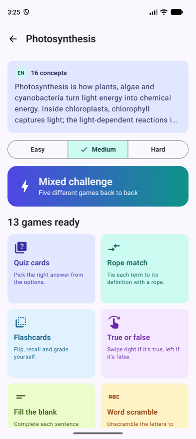
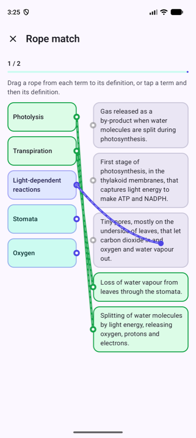
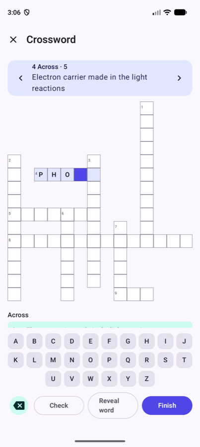
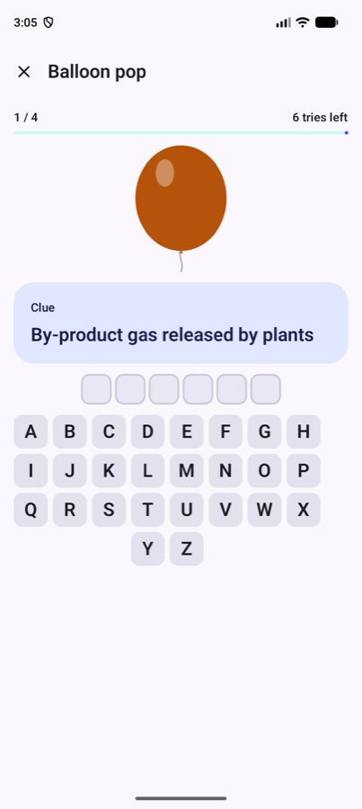
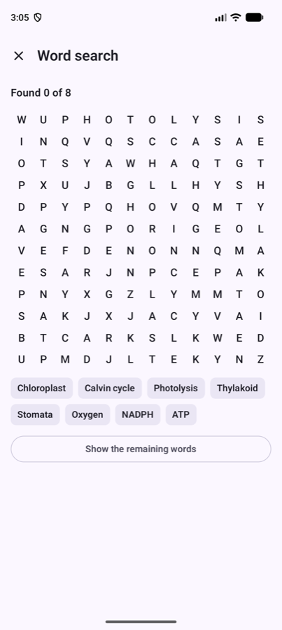
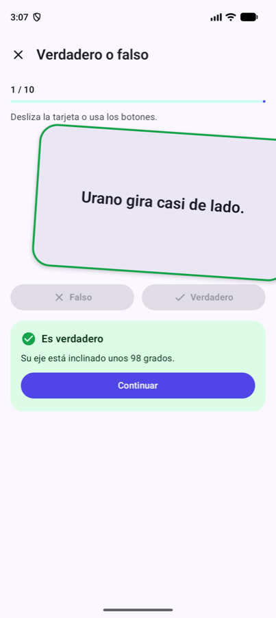
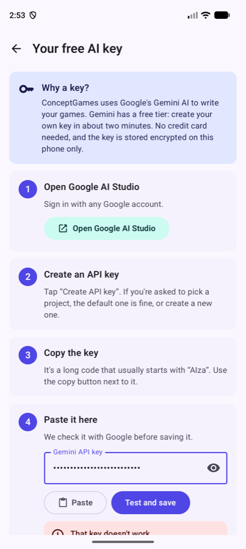
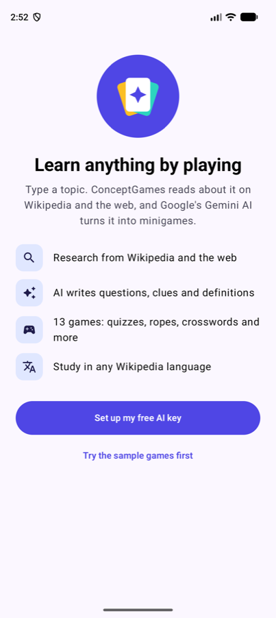

# ConceptGames

**Learn anything by playing.** Type a topic, and ConceptGames researches it on Wikipedia (and optionally the web). Google's free Gemini AI then turns the research into **13 study minigames**: quiz cards, rope matching, crosswords, word search and more.

Open source · no accounts · no ads · no tracking · works in any Wikipedia language.

<p>
  
  
  
  
</p>
<p>
  
  
  
  
</p>

## How it works

```
Topic + language ──► Wikipedia search ──► you pick the articles
                                              │
                    optional Google Search ◄──┤ (Gemini grounding)
                                              ▼
                    1 Gemini call → StudyPack (concepts, facts, questions, sentences, timelines, groups)
                                              ▼
                    13 games built on the device from that pack · saved offline · replays cost nothing
```

* **One AI call per topic.** The AI writes a single structured *StudyPack*, and every game is generated from it locally. That keeps you comfortably inside the free tier.
* **Grounded in sources.** The model only works from the Wikipedia text you choose. The study hub links every source with its CC BY-SA attribution.
* **Adaptive practice.** Concepts you miss come back more often in later rounds.

## The games

| | | |
|---|---|---|
| 🃏 Quiz cards | 🪢 Rope match | 🔤 Word scramble |
| ✏️ Crossword | 🔁 Flashcards | 👉 True or false (swipe) |
| ⬜ Fill the blank | 📅 Put in order | 🔎 Word search |
| 🎈 Balloon pop (hangman, no gallows) | 🧠 Memory pairs | 🗂️ Sort it out |
| 🕵️ Odd one out | | |

A topic only shows the games it has enough material for. For example, *Put in order* needs a natural sequence.

## Getting started

### Play

1. Install the app and open the sample topics (*Photosynthesis* and *Sistema solar*). They work without a key.
2. To create your own topics, get a **free Gemini API key**. Follow the step-by-step guide: **[docs/API_KEY_GUIDE.md](docs/API_KEY_GUIDE.md)** · [en español](docs/API_KEY_GUIDE.es.md). The same guide is built into the app.

### Build

Requirements: JDK 17+, Android SDK 37.

```bash
git clone https://github.com/BrandonVargas/ConceptGames.git
cd ConceptGames
cp local.properties.example local.properties   # set sdk.dir; optionally gemini.apiKey for debug builds
./gradlew :engine:test :app:assembleDebug
```

## Project structure

| Module | What's inside |
|---|---|
| `engine/` | Pure Kotlin, no Android. The `StudyPack` model, the validator that cleans AI output, text normalisation for any script, crossword and word-search generators, and one `GameBuilder` per minigame. Fast unit tests. |
| `app/` | Jetpack Compose UI (Material 3, Navigation 3), Wikipedia and Gemini REST clients (Ktor), Room storage, and an encrypted key store. |

Key files:

* `engine/.../games/GameCatalog.kt`: the list of games
* `app/.../data/gemini/PackPrompt.kt`: the prompt and response schema
* `app/.../domain/GeneratePackUseCase.kt`: research → AI → validation → storage
* `app/.../ui/games/`: one composable per game

## Contributing

New minigames are the most welcome contribution. Adding one takes three small pieces; see **[CONTRIBUTING.md](CONTRIBUTING.md)**.

## Privacy

Your topics and the selected Wikipedia text are sent to the Gemini API with **your own key**. Nothing is sent anywhere else. See [PRIVACY.md](PRIVACY.md).

## License

Code: [Apache License 2.0](LICENSE). Wikipedia content used in packs: [CC BY-SA 4.0](https://creativecommons.org/licenses/by-sa/4.0/), credited in each topic's sources.
